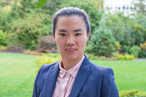

## Dr. Yan Li

{width="165" height="110" fig-alt="Dr. Yan Li"}

Education:

- Ph.D., Electrical Engineering, University of Connecticut, 2019
- Ph.D., Electrical Engineering, Tianjin University, 2013
- B.Sc., Electrical Engineering, Tianjin University, 2008

Honors and Awards:

- CAREER Award, National Science Foundation 2026
- Outstanding Service Award, IEEE Computer Society Annual Symposium on VLSI 2025
- Charles H. Fetter University Endowed Fellowship 2023
- IEEE-PES Outstanding Engineer Award 2019
- Winner of Women of Innovation, Connecticut Technology Council 2019
- Outstanding Reviewer for the IEEE Transactions on Power Systems 2019
- UConn Outstanding Senior Women Academic Achievement Award 2019
- Rising Star Award, Connecticut Power and Energy Society 2018

Biography:

Yan Li (S'19) received her first Ph.D. degree from Tianjin University, Tianjin, China, in 2013, and finished her second Ph.D. program at the University of Connecticut, Storrs, CT, U.S., in 2019, both in electrical engineering. Dr. Li joined Penn State University on Aug. 15, 2019. Her research interests include quantum computing for power systems, machine learning and power grid data mining, cyber-physical microgrids and networked microgrids, formal analysis, cyber-physical security, power system stability and dynamic control, and communication networking.

## Ph.D. Students

Yuqi Jiang\
Jianing Chen\
Hanyang He\
Shuyang Ma\
Joseph Maxwell Lange\
Yuchen Luo

## Master Students

## Undergraduate Researchers

Anant Ruminkumar Patel\
Taemin Kang\
Ananya Vyas 

## Military-Affiliated Researcher

Carter Househnecht -- 2nd lieutenant, Learning Assistant, 2020-2021

## Alumni

Xinyuan Jiang -- Ph.D., 2020-2025, University of Texas at Arlington\
Apoorva Nandakumar -- Ph.D., 2019-2024, joined Tesla Inc.\
Andrew Smith -- Master, 2021-2024, joined Naval Surface Warfare Center\
Joseph William Brogan -- Undergraduate researcher, 2024-2025\
Shaivi Tomar -- Undergraduate researcher, 2023-2024\
Marian Hanashiro Rempola -- Undergraduate researcher, 2023-2024\
Rohin Kalra -- Undergraduate researcher, 2023-2024\
Jaden Peacock -- Undergraduate researcher, 2024\
Kanishka Bhanu Pratap Chandrakar -- Undergraduate researcher, 2024\
Matthew Logan Anderson -- Undergraduate researcher, 2023, joined XSolutions\
Brian Nguyen -- Master, 2022-2023, joined Applied Physics Laboratory at Johns Hopkins University\
Ryan Delany -- Undergraduate researcher, 2022-2023, joined Hoover Rehabilitation\
Anastasia Borochok -- Undergraduate researcher, 2022-2023\
Sarah Margaret Will -- Undergraduate researcher, 2022-2023\
Jidapa Chalermkit -- Undergraduate researcher, 2022-2023\
Fanfu Wu -- Master, 2021-2022\
Zhiran Li -- Master, 2020-2022\
Ethan Liu -- Undergraduate researcher, 2021-2022, joined KMPG\
Justin Michael Szatkowski -- Undergraduate researcher, 2021-2022, joined Barry Wehmiller Design Group\
Pierce Jack McKelvey -- Undergraduate researcher, 2021-2022\
Lixian Yan -- Undergraduate researcher, 2021-2022, Stanford University\
Jiaquan Lin -- Undergraduate researcher, 2021-2022\
Zihao Xu -- Master, 2020-2021, joined ECAC, Inc.\
Shuyang Ma -- Master, 2020-2021\
Eduardo Diaz -- Drawdown Scholar, 2021\
Keili A Tucker -- Drawdown Scholar, 2021\
Zerui Li -- Intern, 2020-2021\
Qicong Sun -- Intern, 2020-2021\
Anthony Elias -- Intern, 2020
