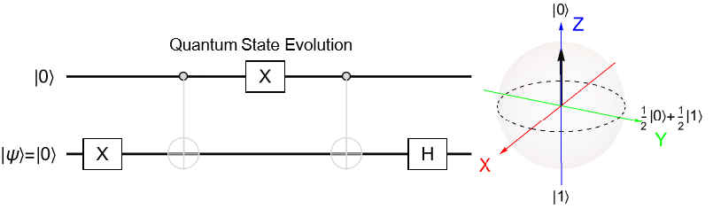
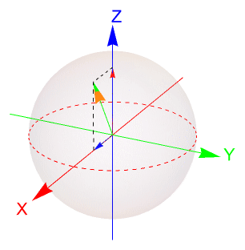
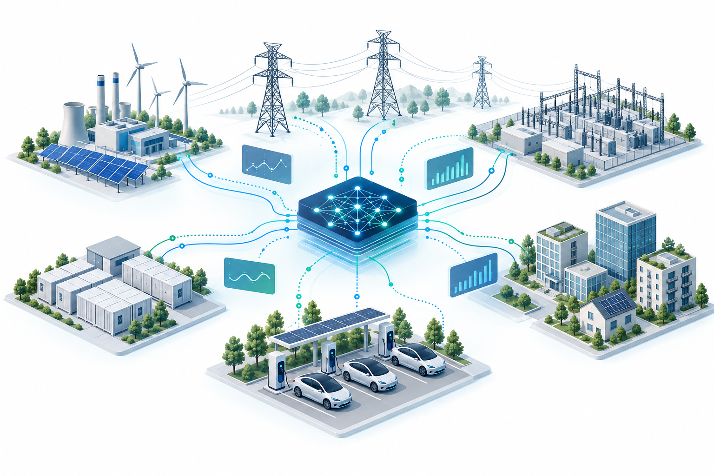
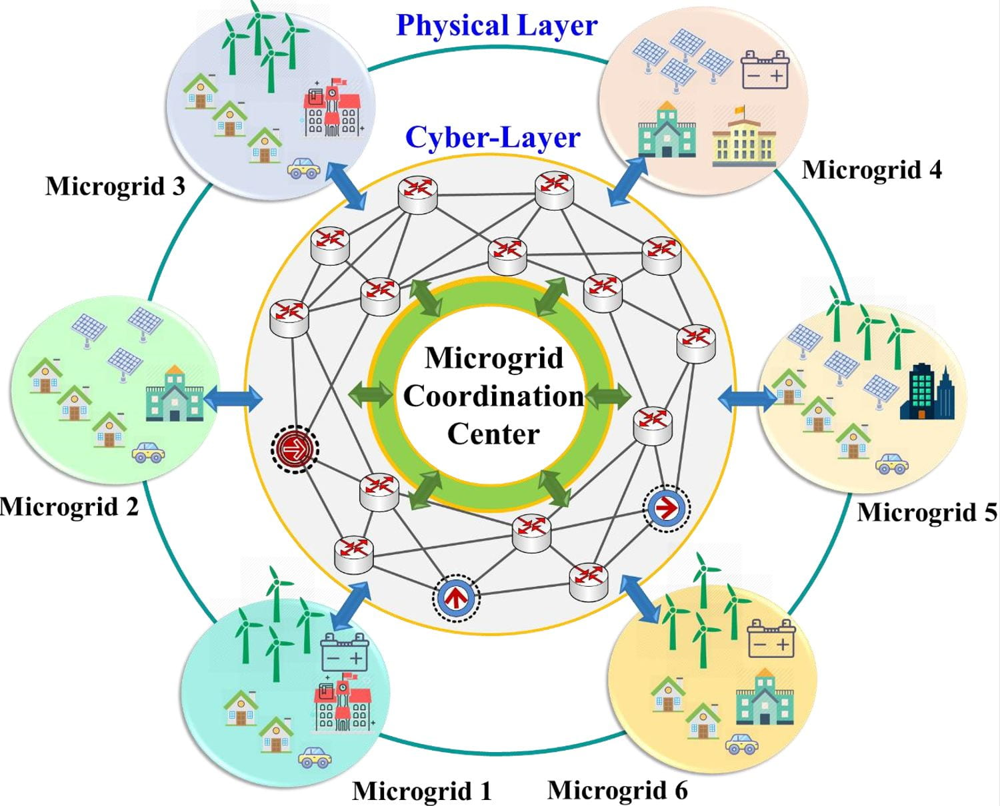

The research group explores new approaches to modeling, computation, and control of dynamical systems, with modern power systems serving as a key application domain. Our research brings together quantum computing, artificial intelligence, and secure communications to support reliable, adaptable grids with increasingly diverse energy resources.

## Quantum Computing for Power Systems

We explore how quantum computing can address the growing computational demands of grid optimization, simulation, and control. Our work spans **hybrid variational algorithms** and methods for **future fault-tolerant quantum computers**, connecting quantum computation with the network structure and dynamic behavior of power systems. The aim is to develop scalable approaches for increasingly complex energy networks.

Quantum computing represents information using **qubits** rather than classical bits. While a classical bit takes either the value 0 or 1, a qubit can be in a superposition,

$$
|\psi\rangle = \alpha|0\rangle + \beta|1\rangle.
$$

A pure single-qubit state can be visualized geometrically using the **Bloch sphere**. Points on its surface represent quantum states, providing an intuitive picture of superposition, amplitude, and relative phase. The illustration below pairs a quantum circuit with a Bloch-sphere view.

::: quantum-animation
{width="805" fig-alt="Animated two-qubit circuit with quantum gates and an accompanying Bloch-sphere state visualization."}
:::

Quantum computation is performed by applying **quantum gates** to these states. Single-qubit gates rotate an individual quantum state, while multi-qubit gates can create interactions and entanglement between qubits.

::: quantum-animation
{width="306" fig-alt="Animated Bloch sphere showing changing quantum-state vectors relative to the X, Y, and Z axes."}
:::

## Machine Learning and AI for Power Systems

**Machine learning and artificial intelligence** turn energy data into insights for forecasting, monitoring, and decision-making. Their ability to learn complex patterns and adapt to new information is well suited to power systems, where demand varies, resources are distributed, and devices interact across large networks.

::: home-illustration
{width="720" fig-alt="Conceptual illustration connecting a central AI network with power generation, transmission, energy storage, buildings, and electric vehicle charging."}
:::

By combining **data-driven learning with physical knowledge**, we explore ways to anticipate system behavior and support coordinated operation. This connection helps bring intelligent methods closer to the reliability and operating constraints of real power infrastructure.

## Cyber-Physical Security for Power Systems

Power systems are **cyber-physical systems**: physical equipment operates through continuous interaction with sensors, communication networks, and digital controllers. This connectivity enables flexible coordination, but also means that compromised data or disrupted communication can affect physical operation.

::: home-illustration
[{width="720" fig-alt="Overview of networked microgrids linking the physical energy layer, a cyber communication network, and a central microgrid coordination center."}](assets/a086040e-home.jpg){target="_blank"}
:::

**Cyber-physical security** connects the protection of information with the behavior of the grid itself. We explore how secure information exchange, system monitoring, and resilient control can work together to detect threats and maintain dependable operation. The aim is to support energy systems that can withstand disruptions and recover while respecting their physical operating limits.
