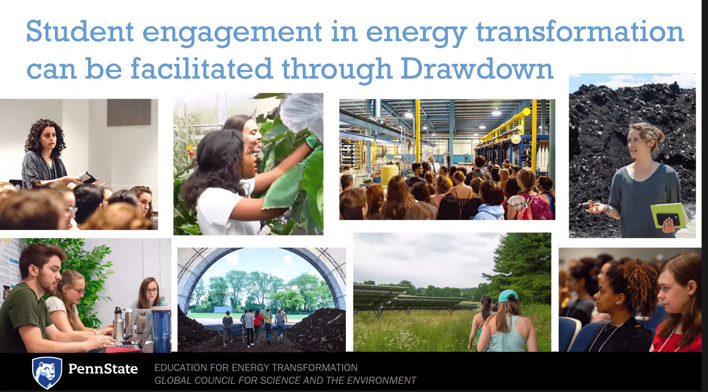
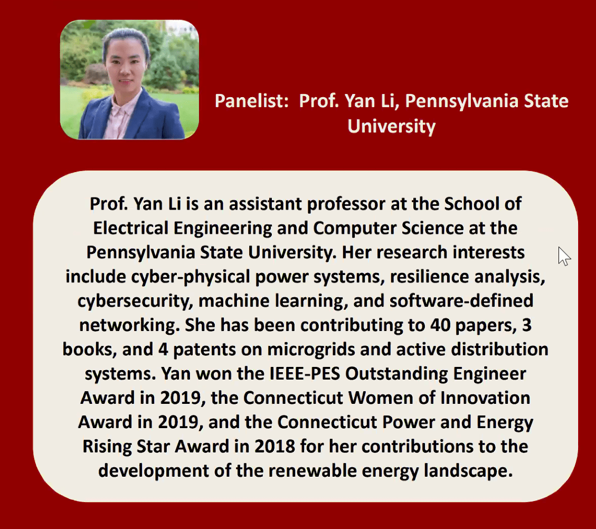
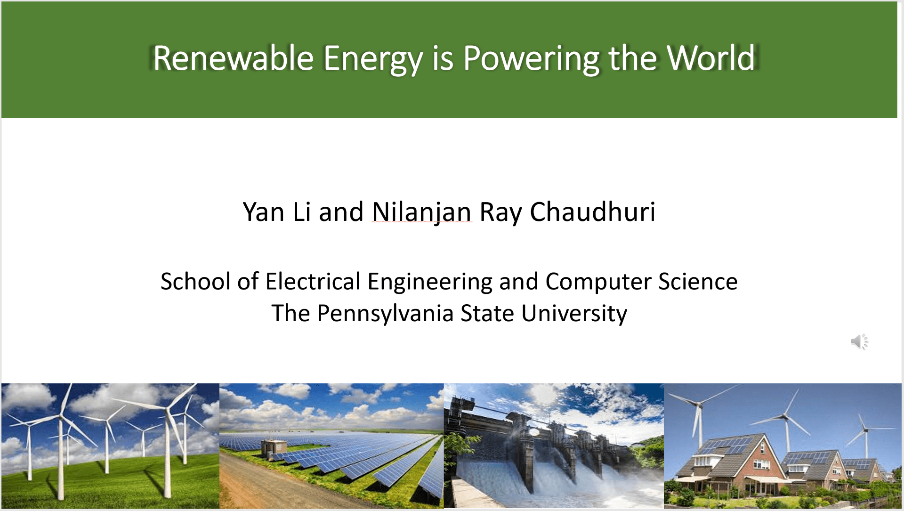

## APOGEE Summer Camp

Dr. Yan Li participated in the 2021 APOGEE Summer camp and gave a presentation on "Powering the World using Renewable Energy." APOGEE stands for Anything is POssible for Girls in Electrical Engineering. It is an annual event of the EE department and was organized virtually this year during July, 19-23, 2021.\
Website: <https://www.eecs.psu.edu/community/EE-Camp.aspx>

## Drawdown Project

Dr. Yan Li led a Drawdown project team in 2021 summer to work on "Improving the resilience of power grids through integrating sustainable energy units." Two REU students, Eduardo Diaz and Keili A Tucker, were working on that project.

{width="276" height="153" fig-alt="Drawdown project"}

## Sharing Career Experiences with Young Researchers

Dr. Yan Li participated in the panel of Young Professionals in Engineering in 2021 IEEE International Electric Machines & Drives (IEMDC). She gave a presentation on "Careering in Engineering Educator," and shared her research and career experiences with young students, researchers, and investigators.  IEMDC was organized virtually this year during May 16-18, 2021.

{width="266" height="236" fig-alt="Young Professionals in Engineering presentation"}

## Community Education Extended Learning (CEEL) Program

CEEL is an afterschool extended learning program open to all elementary students. To give young students a flavor of renewable energy, Dr. Yan Li and Dr. Ray Chaudhuri developed a courseware "Renewable Energy is Powering the World." It was exclusively developed for the CEEL program to sow the seed of renewable energy in the next generation.\
CEEL website: <https://www.scasd.org/CEEL>\
Courseware website: <https://sites.psu.edu/eecsceelk12/>

{width="273" height="154" fig-alt="Renewable energy community education program"}

## Mentorship

Dr. Yan Li is a mentor of the Research Experiences for Undergraduates (REU) Program, mentoring Drawdown scholars on sustainable energy projects. She is also a mentor of Women+ in Statistics and Data Science at Penn State, providing mentoring opportunities to students and post-docs, especially for those from underrepresented groups.
