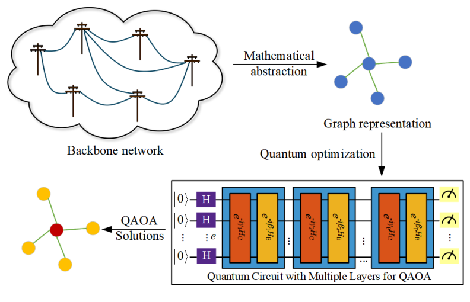
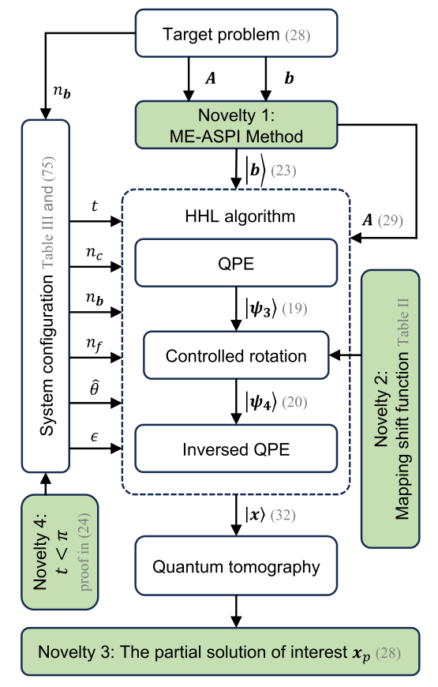
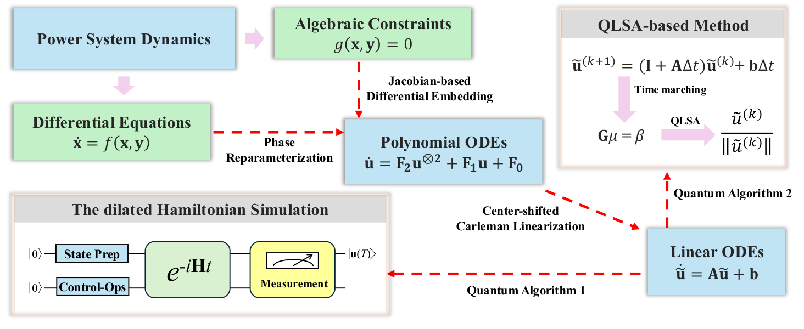
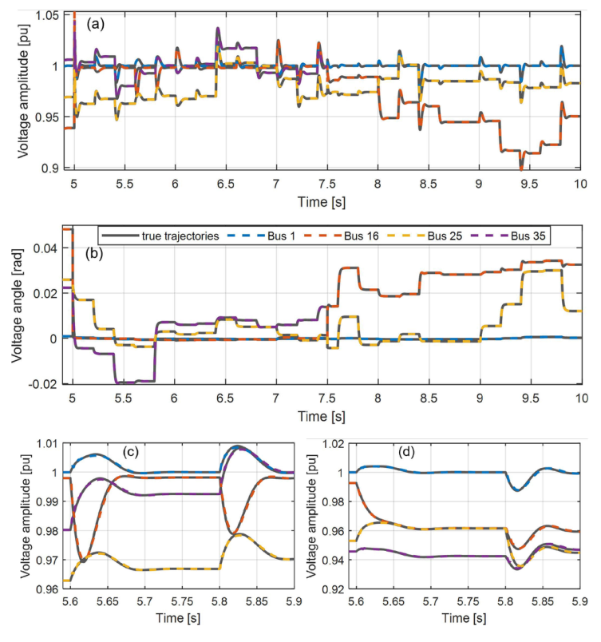
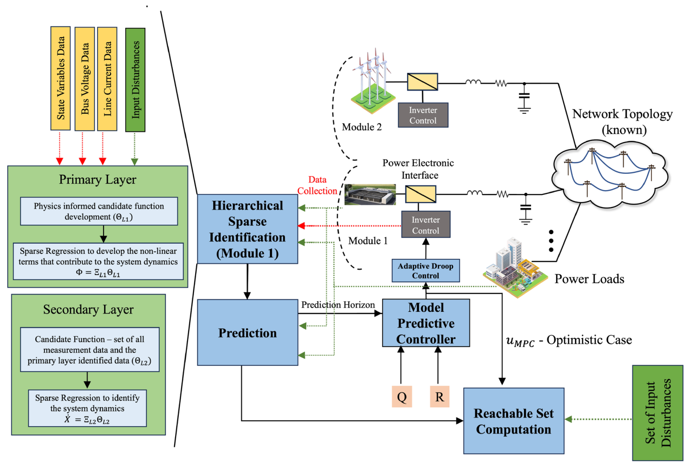
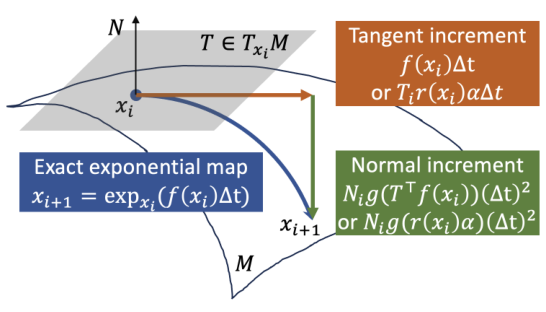
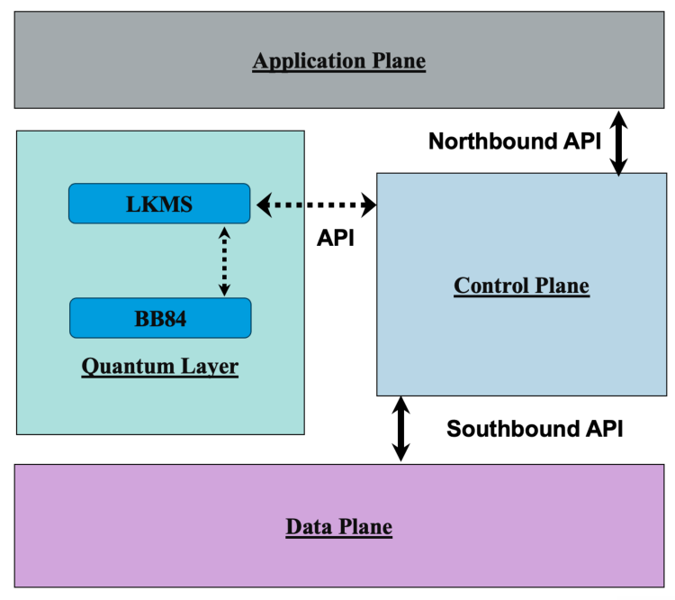

Our research connects quantum algorithms, data-driven models, and secure communications with the structure and operating needs of modern power systems.

## **Highlight 1: Quantum Computing for Power Systems**

### Variational Algorithms: Optimal PMU Placement

:::: research-item
A hybrid quantum-classical QAOA framework combines PMU installation cost with grid-observability constraints. Graph-based feasibility checks and landscape optimization connect variational quantum circuits with the network structure of the placement problem.

::: research-visual
[{fig-alt="Power network represented as a graph and encoded into a parameterized QAOA circuit for PMU placement."}](assets/research/quantum-pmu.png){target="_blank"}
:::

Tests on IEEE 9-, 14-, 24-, and 30-bus systems examine both unrestricted and channel-limited PMUs, showing how tailored observability modeling and parameter optimization improve placement solutions.

::::

### Quantum Linear Solvers: Predictive Microgrid Control

:::: research-item
A refined HHL solver uses a mapping function to handle indefinite linear systems and matrix extension to increase sampling of the required control inputs. This matches receding-horizon MPC, which applies only the first control action from each optimized sequence.

::: research-visual
[{fig-alt="Flowchart of matrix extension, the modified HHL algorithm, and partial control-input extraction."}](assets/research/quantum-mpc.png){target="_blank"}
:::

Numerical microgrid examples demonstrate control performance and improved partial-solution sampling. The study establishes a quantum-classical control framework; implementation on quantum hardware remains future work.

::::

<!--
### Toward Fault-Tolerant Quantum Dynamic Simulation

:::: research-item
Differential embedding, polynomial reparameterization, and center-shifted Carleman linearization transform nonlinear power-system differential-algebraic equations into a form compatible with quantum linear-system solvers and dilated Hamiltonian simulation.

::: research-visual
[{fig-alt="Carleman framework connecting power-system differential and algebraic equations to linear dynamics and two quantum solver pathways."}](assets/research/quantum-dynamics.png){target="_blank"}
:::

The framework tracks nonlinear trajectories on 10-, 39-, and 57-bus benchmarks. Validation is numerical, including operator-level simulation on classical computers; computational benefits on future fault-tolerant hardware remain prospective.

::::
-->

## **Highlight 2: Machine Learning and AI for Power Systems**

### Modular Koopman Models for Changing Grid Topologies

:::: research-item
The modularized Koopman bilinear form learns reduced subsystem models from data and reconnects them through the electrical network. This modular structure suits distributed energy resources and avoids retraining a single large model whenever the microgrid is reconfigured.

::: research-visual
[{fig-alt="Voltage magnitude and angle predictions closely track reference trajectories as microgrids connect and separate."}](assets/research/ai-koopman.png){target="_blank"}
:::

Transient predictions follow voltage and current responses under disturbances, including the connection and separation of microgrids. The results demonstrate plug-and-play prediction across changing network topologies.

::::

### Physics-Informed Learning for Adaptive Droop Control

:::: research-item
Hierarchical, physics-informed sparse identification supplies a predictive model for MPC, which adjusts conventional droop control. Combining learned dynamics with physical structure addresses the nonlinear transients and low inertia of inverter-based microgrids.

::: research-visual
[{fig-alt="Overall framework combining hierarchical physics-informed sparse identification, transient prediction, adaptive droop control, model predictive control, and reachable set computation."}](assets/research/ai-predictive-control.png){target="_blank"}
:::

Simulations show faster frequency stabilization than conventional droop control. Reachability analysis additionally evaluates the controller under bounded disturbances, connecting data-driven prediction with operating-range assessment.

::::

### Geometry-Preserving Learning of Nonlinear Dynamics

:::: research-item
Geometrically constrained kernel ridge regression learns nonlinear dynamics while respecting the underlying manifold structure estimated from data. A geometry-preserving time integrator combines motion along the tangent space with a normal correction, helping predicted trajectories remain close to the manifold. This offers a foundation for learning constrained dynamics, including those arising in power-system models.

::: {.research-visual .research-visual-manifold}
[{fig-alt="Manifold diagram decomposing a state update into a tangent increment and a normal correction to approximate evolution along the manifold."}](assets/research/ai-manifold.png){target="_blank"}
:::

Tests on cavity flow, Kuramoto-Sivashinsky waves, and reaction-diffusion dynamics demonstrate improved long-term prediction accuracy and lower training costs against the compared baselines. The study establishes a general method for constrained dynamical systems; power-grid applications remain a direction for further investigation.

::::

## **Highlight 3: Cyber-Physical Security for Power Systems**

### Quantum Key Distribution for SDN Communications

:::: research-item
The proposed architecture combines BB84 quantum key distribution with local key management to protect software-defined networking control communications. This offers a communication-security direction for digitally controlled grids that depend on trustworthy messages between controllers and network devices.

::: {.research-visual .research-visual-qkd}
[{fig-alt="Architecture linking a BB84 quantum layer and local key management to the application, control, and data planes of SDN."}](assets/research/cps-qkd.png){target="_blank"}
:::

The paper presents architecture and protocol simulations using Mininet and Qiskit. Full control-layer integration remains future work; the demonstrated scope is communication security, rather than power-system stability validation.

::::
