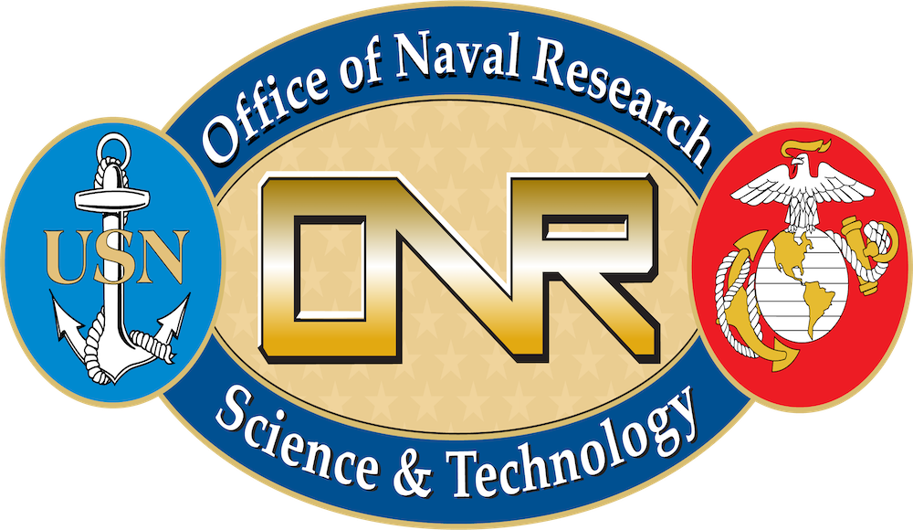
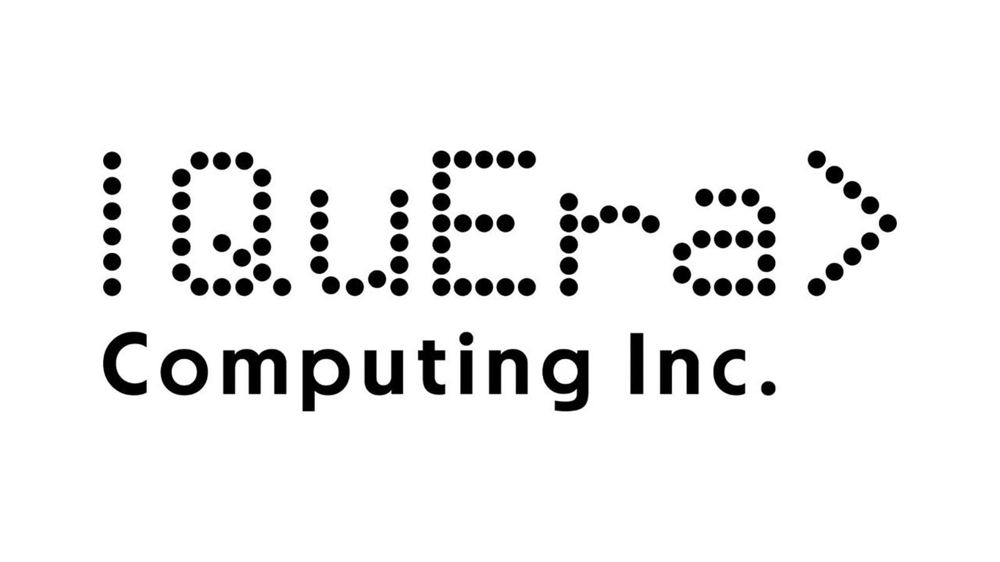

We gratefully acknowledge the support of ONR, NSF, NSWC, AWS, QuEra, IonQ, Air Force Research Laboratory, Eaton Research Labs, and Appalachian Regional Commission.

### Office of Naval Research {.sponsor-logo fig-alt="Office of Naval Research"} {.sponsor-heading}

- ONR YIP: Quantum Analysis on Transient Dynamics of Distributed Renewable Energy Systems

### National Science Foundation {.sponsor-logo fig-alt="National Science Foundation"} {.sponsor-heading}

- CAREER: Q-GRID: Transforming Next-Generation Power Grid Computation with a Unified Quantum-Classical Paradigm. 
- Collaborative Research: Variational Quantum Technology for Seamless Transition Between Grid-Following and Grid-Forming Controls for Inverter-Based Resources. 
- CyberTraining: Pilot: Immersive and Collaborative Quantum Computing Training for Power System
- AMPS: Compositional Data-Driven Modeling, Prediction and Control for Reconfigurable Renewable Energy Systems. 

### Naval Surface Warfare Center {.sponsor-logo fig-alt="Naval Surface Warfare Center"} {.sponsor-heading}

- Unifying and Securing Naval SCADA Networks through Scalable SDN. 

### Air Force Research Laboratory [{.sponsor-logo fig-alt="Air Force Research Laboratory (AFRL)"}](https://afresearchlab.com/) {.sponsor-heading}

- Quantum-Enabled Combinatorial Optimization: An End-to-End Demonstration. 

### Eaton Research Labs [{.sponsor-logo fig-alt="Eaton Research Labs - Eaton logo"}](https://www.eaton.com/us/en-us/company/research-and-development.html) {.sponsor-heading}

- Quantum Computing for Resiliency and Security. 

### Appalachian Regional Commission [{.sponsor-logo fig-alt="Appalachian Regional Commission"}](https://www.arc.gov/) {.sponsor-heading}

- Quantum Appalachia: Forging the Future of Economic Growth and Secure Connectivity.

## Industry Collaborators

::: industry-collaborators
::: industry-collaborator
### Amazon Web Services {.collaborator-logo fig-alt="Amazon Web Services"}
:::

::: industry-collaborator
### QuEra {.collaborator-logo fig-alt="QuEra"}
:::

::: industry-collaborator
### IonQ {.collaborator-logo fig-alt="IonQ"}
:::
:::
